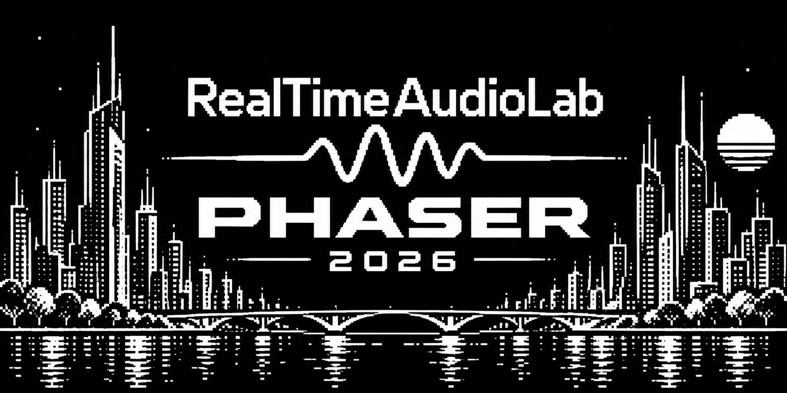
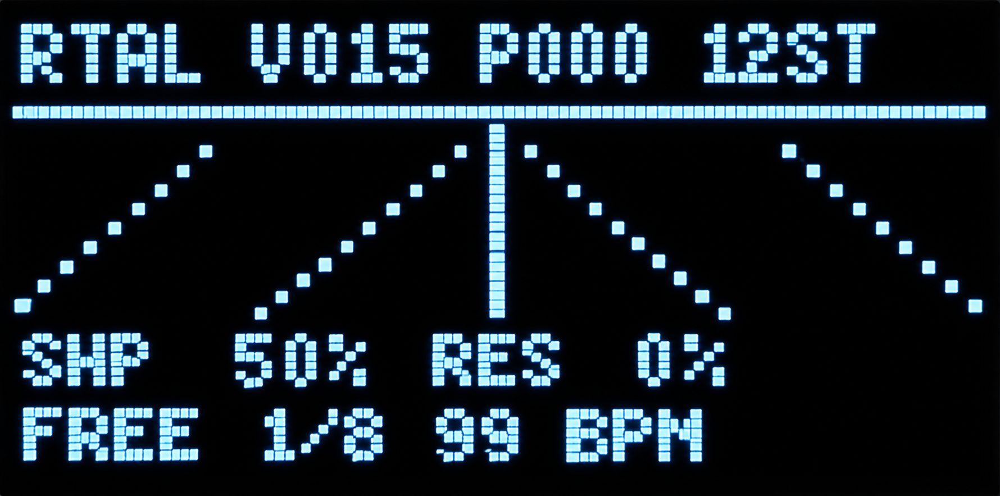
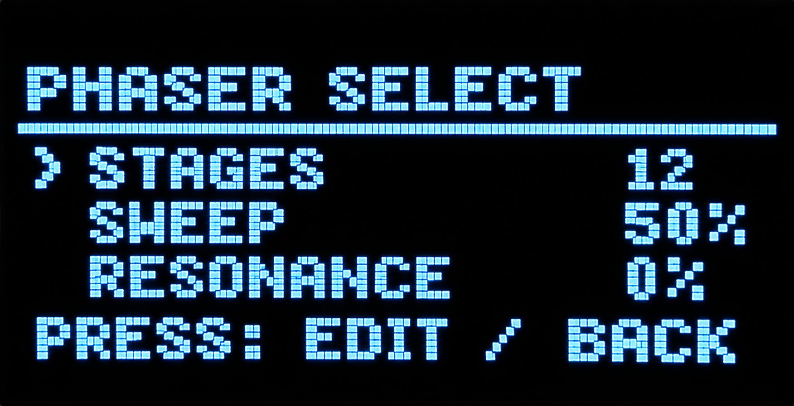
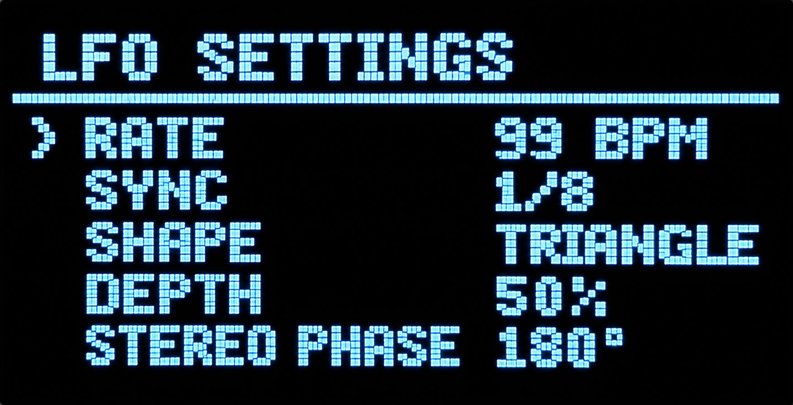
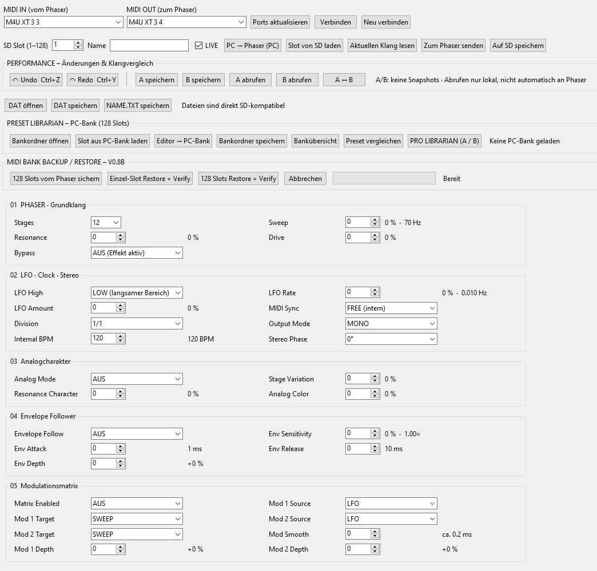
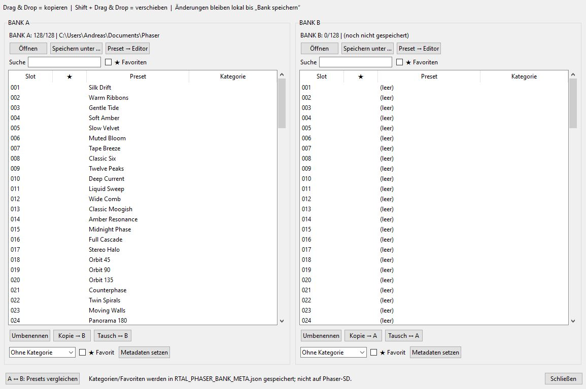

# HQ Digital Phaser

**RealTimeAudioLab · ESP32-S3 · Digital Stereo Phaser · 6/12 stages · 128 SD presets · Windows MIDI Editor**

A digital stereo phaser inspired by the classic **Moog MF-103** concept, developed independently by **RealTimeAudioLab** for an ESP32-S3 audio platform. This is an independent project and is not affiliated with or endorsed by Moog Music.

The HQ Digital Phaser combines a real-time DSP phaser engine, flexible modulation, MIDI control, a 128-preset SD soundbank, and a dedicated Windows editor with bidirectional MIDI communication and a two-bank librarian.

## Hardware photographs

The following four image references are retained from the existing repository. Keep the original files in `images/`:

## Windows editor – main view

*Editor screenshot: MIDI input/output selection, SD slot, LIVE control, Undo/Redo, A/B comparison, bank backup/restore, and grouped effect parameters.*

The editor provides direct access to the Phaser, LFO/Clock/Stereo, Analog Character, Envelope Follower and Modulation Matrix groups. Numeric values are complemented by meaningful labels, percentages, frequency/time indications, and parameter tooltips. MIDI IN/OUT choices can be remembered across launches. The SD slot defaults to **1** in the newer editor build.

### Main editor features

| Feature | Description |
|---|---|
| MIDI IN / MIDI OUT | Select ports, connect, refresh, or reconnect; remember last successful ports |
| LIVE | Send edited parameters to the connected phaser |
| SD slots | Read current sound, load from SD, transmit a preset, or save to SD |
| Undo / Redo | Undo and restore local parameter changes |
| A/B comparison | Store two editor sound states and switch between them |
| Preset file I/O | Open/save SD-compatible `.DAT` and `.TXT` files |
| PC bank | Open, edit, and save a 128-slot bank folder |
| MIDI backup | Receive all 128 SD presets and names from the hardware |
| MIDI restore | Restore a single slot or the entire bank, with readback verification |
| Connection and data safety | Reconnect support, overwrite prompts, backup copies, transfer logging (RC5 line) |

**A/B playback note:** Retrieving an A or B snapshot changes the editor state locally. Use **“Zum Phaser senden”** to hear that snapshot on the hardware; the A/B recall does not automatically transmit it.

**Safety:** Back up your SD card before any full-bank restore. The restore overwrites destination slots; aborting does not undo slots already written.

## Windows editor – PRO LIBRARIAN

*PRO LIBRARIAN screenshot: two 128-slot PC banks, drag-and-drop transfer, categories, favorites, search, and preset comparison.*

The **PRO LIBRARIAN (A / B)** opens two independent PC banks side by side. It supports copying by drag-and-drop, moving with **Shift + drag-and-drop**, swapping presets, renaming, searching, category assignment, favorites, and comparing parameters across banks. Changes stay in the PC banks until you explicitly save the relevant bank folder. Category/favorite metadata is PC-side and is **not** written to the phaser's SD preset files.

### Quick workflow: copy a sound from Bank A to Bank B

1. Open **PRO LIBRARIAN (A / B)** in the editor.
2. Click **Öffnen** in Bank A and select the source bank folder.
3. Open or prepare a destination folder for Bank B.
4. Drag a preset from Bank A to the desired slot in Bank B (or use **Kopie → B**).
5. Click **Speichern unter...** for Bank B to save the changed bank.
6. To send a sound to hardware, load it into the editor and use the appropriate MIDI transfer/save action.

### Quick workflow: back up the complete phaser

1. Connect both MIDI ports and verify communication.
2. Click **128 Slots vom Phaser sichern**.
3. Wait for completion of all **128/128** slots.
4. Save the received PC bank to a dedicated folder.
5. Keep an additional independent backup before experimenting with restore.

## DSP features

- Selectable **6- or 12-stage** all-pass phasing with sweep, resonance, and drive.
- Analog-character controls: stage variation, resonance character, and analog color.
- LFO with low/high range, adjustable rate/amount, MIDI Clock synchronization, internal tempo, rhythmic divisions, and stereo phase offsets.
- Mono, Main/Aux, and stereo output configurations.
- Envelope follower with sensitivity, attack, release, and bipolar depth.
- Two independent modulation routes: **LFO or Envelope → Sweep, Resonance, or Drive**, with bipolar depths and smoothing.
- 128 SD-card presets, selectable from the hardware or via MIDI Program Change.

## Hardware reference

| Component | Connection / specification |
|---|---|
| MCU | ESP32-S3 |
| Audio ADC | PCM1808, I²S data input GPIO5 |
| Audio DAC | PCM5102A, I²S data output GPIO17 |
| Audio clock | BCLK GPIO18, LRCK GPIO16, MCLK GPIO0 (hardware-dependent) |
| Display | SSD1309 OLED 128×64, SPI SCK12, MOSI11, CS10, DC6, RST7 |
| Encoder | A GPIO1, B GPIO2, switch GPIO42 |
| SD card | SPI SCK12, MOSI11, MISO13, CS9 |
| DIN MIDI | RX GPIO40, TX GPIO39, 31250 baud |
| Audio processing | 32 kHz, 128-frame blocks (documented firmware basis) |

**Note:** GPIO assignments apply to this specific hardware design; check the project's schematic before wiring.

## Firmware setup

1. Back up the complete SD folder `/RTAL_PHASER/`, including `MIDI.CFG` and your own sounds.
2. Use **Arduino IDE 2** with ESP32-S3 board support and the required libraries (including U8g2).
3. Open the matching `.ino` file from the firmware version you intend to install; Arduino requires the sketch folder and `.ino` basename to match.
4. Configure the correct ESP32-S3 board, flash/PSRAM options and upload port; compile and upload.
5. Copy a compatible soundbank to `/RTAL_PHASER/` on the SD card, preserving existing personal presets and `MIDI.CFG` where appropriate.
6. Connect audio at a moderate level, start the unit, and test an existing preset.

**Compatibility:** The editor's proven MIDI backup/restore functionality requires the corresponding **P016 FIX4b** firmware. Do not assume that the older P015 release implements the newer editor SysEx commands.

## Windows editor setup

The current editor is distributed as a **Windows Build Kit**. On a Windows PC, extract the kit and run `BUILD_WINDOWS_EXE.cmd` to build a standalone executable. The resulting application is named **HQ_Digital_Phaser_Editor.exe** in the renamed build line. If using an earlier kit, check the filename supplied with that version. The executable does not require Python on the target PC after it has been built.

Connect the phaser through a bidirectional MIDI interface, select the correct **MIDI IN (vom Phaser)** and **MIDI OUT (zum Phaser)** ports, and click **Verbinden**. In the RC5 FIX1+ editor line, the last successfully connected ports are remembered. The selection is restored on restart, but the user still clicks **Verbinden** to open the ports.

## Preset and MIDI compatibility

- SD folder: **`/RTAL_PHASER/`** (legacy name retained deliberately).
- Preset files: **`PRESET01.DAT` … `PRESET128.DAT`**; names: **`NAME01.TXT` … `NAME128.TXT`**.
- The documented V5 binary preset structure is **41 bytes**, with a checksum.
- Program Change **0–127** corresponds to preset **001–128**.
- MIDI CC **32** selects controller bank **0** (main parameters) or **1** (modulation matrix).
- The internal MIDI SysEx identity and existing preset storage format are not renamed; this preserves compatibility.

See [`docs/MIDI_CC.md`](docs/MIDI_CC.md) for the full CC mapping if that file is present in your repository.

## Project status

| Component | Current documented status |
|---|---|
| Standalone firmware v1.0.0 (P015 FIX5 basis) | Historical firmware release; original documentation retained |
| Editor-compatible firmware P016 FIX4b | Hardware-tested with MIDI editor |
| Windows editor V1.0 RC4 | User-tested: performance UI, Undo/Redo, A/B |
| Windows editor V1.0 RC5 FIX1 | User-tested: MIDI port memory |
| Windows editor V1.0 RC5 FIX2 | SD slot defaults to 1; separate final test confirmation not recorded here |
| Editor V1.0.0 FINAL | Planned, not yet released |

The project name is now **HQ Digital Phaser**. Older references to *RTAL Phoenix Phaser* may still appear in historical firmware folders, data paths, or file formats by design.

## Documentation and repository layout

- [`docs/MIDI_CC.md`](docs/MIDI_CC.md) — MIDI CC mapping (when present).
- [`docs/HQ_Digital_Phaser_Handbuch_DE.pdf`](docs/HQ_Digital_Phaser_Handbuch_DE.pdf) — updated German user/technical manual (when uploaded).
- [`sdcard_content/PRESET_CATALOG.csv`](sdcard_content/PRESET_CATALOG.csv) — preset catalog (when present).
- Firmware and soundbank directories: retain the **actual names** used in your repository. The older README used `Firmware/RTAL_Phaser_v1_0_0_FINAL/` and `Soundbank/RTAL_PHASER/`; verify these paths before publishing links.

## License and credits

The existing project README specifies **GNU General Public License v3**. Check that the repository includes the corresponding `LICENSE` file and that any bundled third-party components are distributed under compatible terms.

© 2026 **RealTimeAudioLab** · RTAL Embedded Audio Initiative · RTAL-EAI-012.

Acknowledgements: the pioneers of electronic music and classic phaser design; Espressif Systems and the Arduino/open-source audio community.
